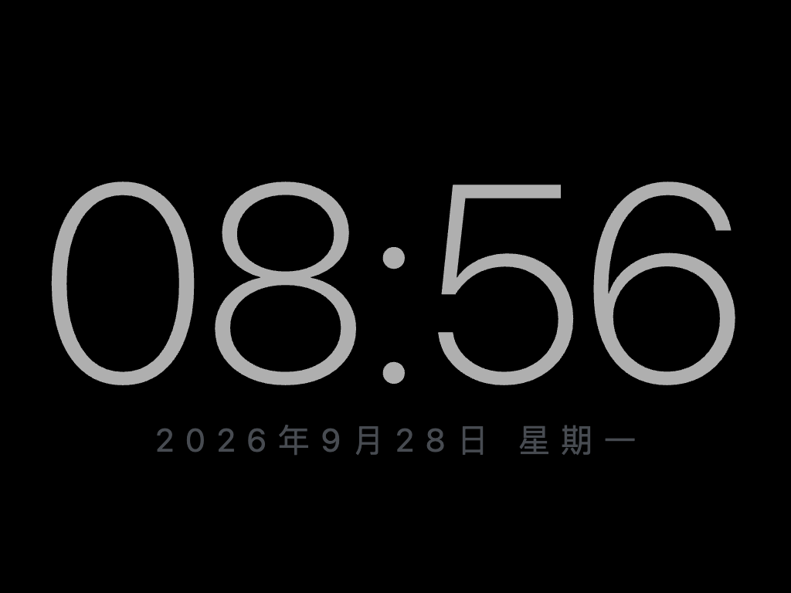

# 全屏时钟（平板常亮 · 低功耗）

**在线直接用：<https://yjw94ss.github.io/tablet-clock/>**

平板浏览器打开上面这个链接 → 「添加到主屏幕」→ 从图标启动即为全屏，
「屏幕常亮」在 https 下才能生效。下面是不依赖网络的本地用法。

一个纯前端的全屏时钟，为「平板长期亮屏当钟表/桌面钟」设计。没有框架、没有 CDN、
没有外链字体，断网可用；核心目标只有一个：**在屏幕一直亮着的前提下，让浏览器尽可能不干活。**

## 文件

| 文件 | 说明 |
|---|---|
| `index.html` | 全部代码（HTML + CSS + JS 单文件，约 20KB） |
| `manifest.webmanifest` + `icon-*.png` | PWA 信息，用于「添加到主屏幕」后全屏启动 |
| `tools/make_icons.py` | 图标生成脚本，纯标准库，`python3 tools/make_icons.py` 可重跑 |

电脑上直接双击 `index.html` 就能预览。

## 怎么放到平板上

**方式一：用 https 链接（推荐，已就绪）**
直接打开 <https://yjw94ss.github.io/tablet-clock/>（GitHub Pages 托管，仓库设置里
Pages → 分支 `main` → 根目录即可复现）。https 是「屏幕常亮」（Wake Lock API）能生效的前提，
也是唯一能让 iPad 真正全屏的方式。

**方式二：局域网**
电脑上 `python3 -m http.server 8000`，平板访问 `http://<电脑IP>:8000/`。
注意 http 不是安全上下文，Wake Lock 会被拒绝；此时改用 iPad 的「辅助功能 → 引导式访问」
或安卓的「充电时保持唤醒」。

**方式三：直接拷文件**
iPad 用「文件」App 打开 html 也能显示，但全屏和常亮都受限，只适合临时看一眼。

### iPad 补充
- Safari **不支持**网页 JS 全屏 API（`requestFullscreen`），必须走「分享 → 添加到主屏幕」，
  从主屏幕图标启动才会没有地址栏。
- 「屏幕常亮」需要 iOS 16.4 及以上。
- 想彻底锁死在时钟界面（防止误触退出）：设置 → 辅助功能 → 引导式访问。

### 安卓补充
Chrome 菜单里「安装应用 / 添加到主屏幕」；网页全屏 API 本身可用，点界面里的「全屏」按钮即可。

## 操作

- **轻触屏幕任意处** → 打开/关闭设置面板（15 秒无操作自动收起）
- 键盘：`F` 全屏 · `S` 切换秒 · `空格` 面板 · `Esc` 关闭（桌面调试用）

设置项：显示秒 / 24 或 12 小时制 / 显示日期 / 4 种主题 / 4 档变暗 / 夜间自动变暗 /
防烧屏微移 / 屏幕常亮。全部存在 localStorage，刷新后自动恢复。

## 省电是怎么做到的

1. **没有逐帧刷新。** 全程不用 `requestAnimationFrame`、不用 CSS 动画、不用 `setInterval` 轮询。
   定时器精确对齐到下一个秒/分边界，醒来一次就够。
2. **只在文本真的变化时才写 DOM。** 秒数、日期都先比对再赋值，值没变就不碰 DOM。
3. **不显示秒时，每分钟只醒一次；不显示日期时，跨天也只多写一次。**
4. **页面不可见就停表**（`visibilitychange`），回到前台立刻校准并重排定时器。
5. **纯黑底 + 细字重**（`font-weight:200`）。OLED 屏上不发光/少发光的像素不耗电。
6. **「变暗」是黑色半透明遮罩**，直接把像素压暗——OLED 上是真实省电，不是改背光。
7. **防烧屏用低频位移**（每 4 分钟挪 2px），而不是呼吸/渐变动画。
8. **零外部请求**：没有远程字体、图标、统计脚本。

## 实测数据

在 Chromium 1024×768 下用页面内置计数器实测（`window.__clock.stats`）：

| 场景 | 定时器唤醒 | DOM 写入 |
|---|---|---|
| 不显示秒，静置 65 秒 | **1** | **1** |
| 显示秒，静置 6 秒 | 6 | 6 |
| 运行中的动效数量 | **0** | — |

也就是说：**默认配置下每小时只唤醒约 60 次、写 DOM 约 60 次**，其余时间页面完全静止。

压力测试：连续 10 次强制刷新后静置 65 秒，唤醒次数仍为 1（验证没有定时器泄漏）。

## 最后一句实话

真正的耗电大头是**屏幕背光**，网页改变不了它。页面能做的是「不浪费 CPU/GPU 唤醒」
和「让发光的像素更少更暗」。所以请把**系统亮度调到你能接受的最低值**——这才是省电的主项。
